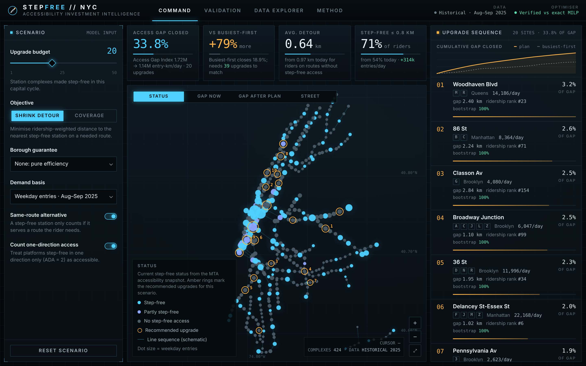
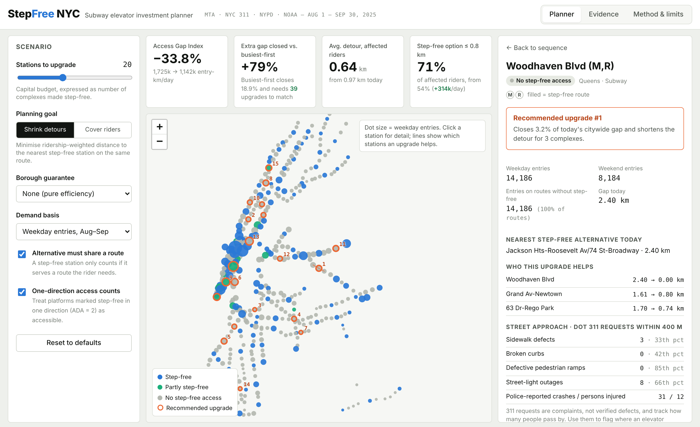
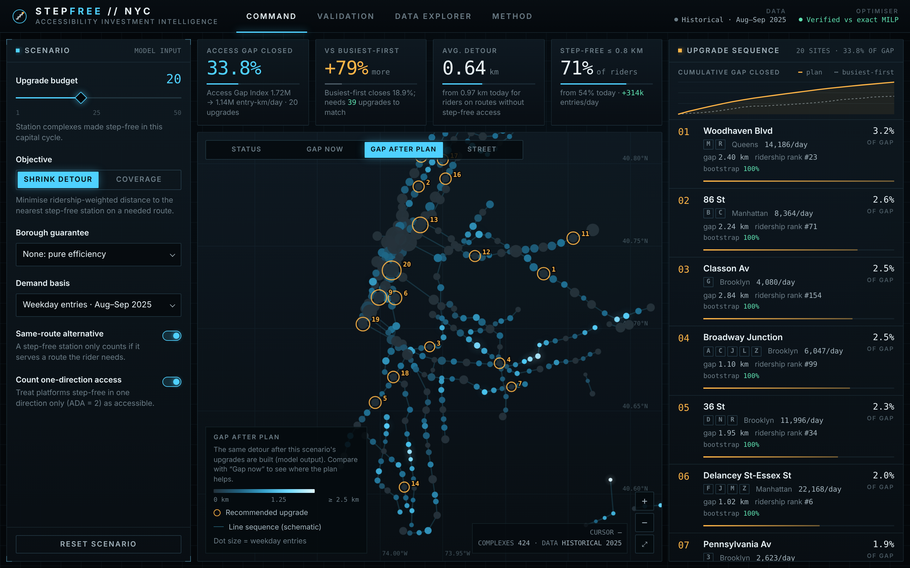
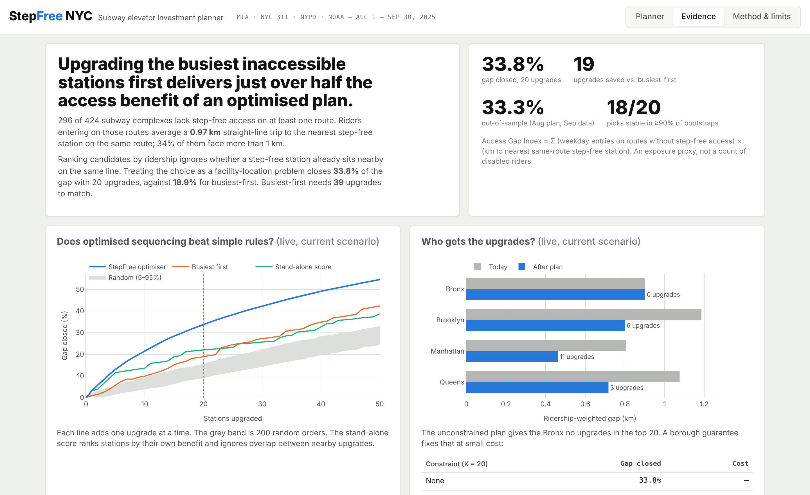
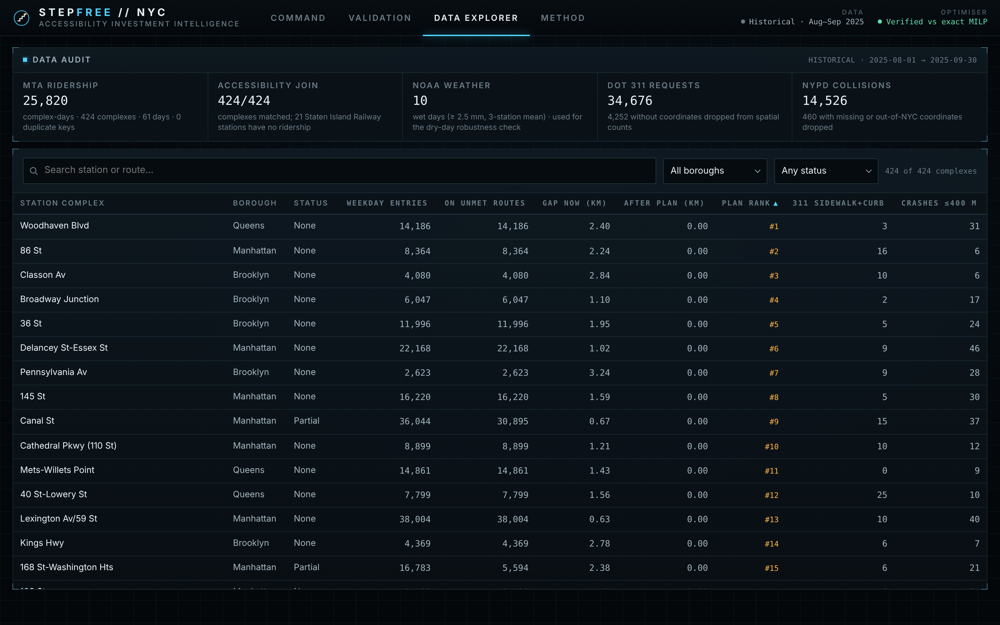
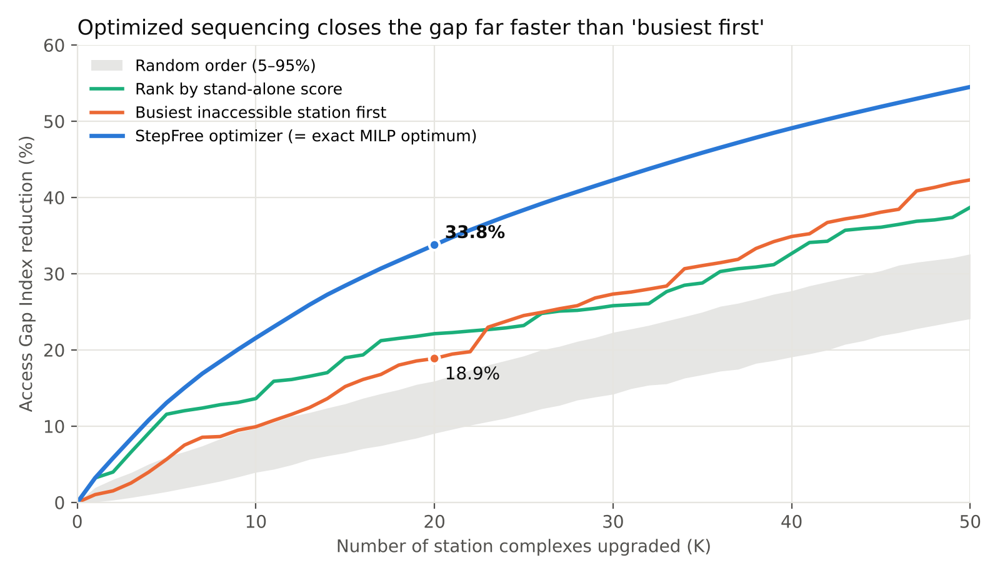
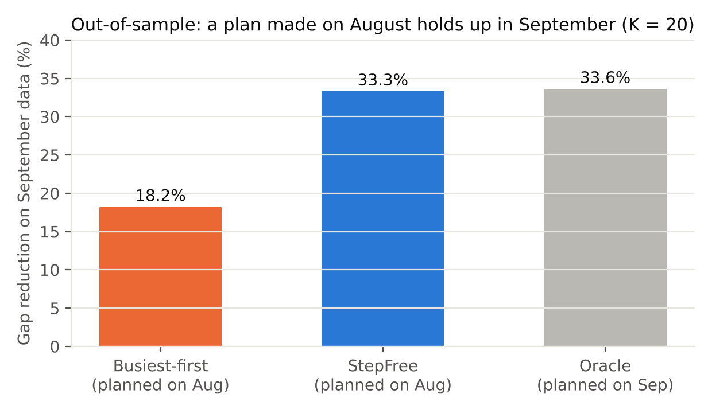
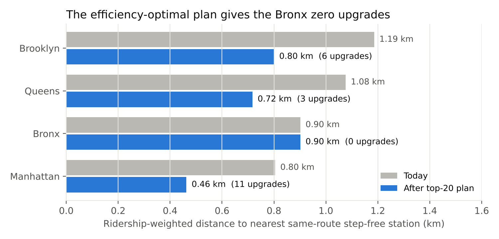

# StepFree NYC

**Repository:** https://github.com/pritish-sharma/stepfree-nyc · **Author:** Pritish Sharma

**A decision-support tool for sequencing NYC subway elevator (ADA) upgrades.**
Rutgers Data Science Club · NYC in Motion Datathon · November 7, 2026 · Track: Accessibility & Equity



> **Upgrading the busiest inaccessible stations first gets just over half the access benefit of an optimized plan.**
> With the same 20 upgrades, our optimizer closes **33.8%** of the citywide accessibility gap. Busiest-first closes **18.9%** and needs **39** upgrades to match.

---

## 1. Problem

Under a June 2022 legal settlement, the MTA agreed to make 95% of subway stations accessible by 2055 ([NY Governor's office](https://governor.ny.gov/news/governor-hochul-announces-mta-and-accessibility-advocates-agree-historic-plan-expanding)). Elevators are expensive and slow to build, so every capital cycle has to answer the same question:

> **Given a budget of K station upgrades, which station complexes should be made step-free next, and in what order?**

The intuitive rule is "upgrade the busiest inaccessible stations." It ignores two things:
- **Redundancy.** A busy station 300 m from a step-free station on the same line gains little from an elevator.
- **Spillover.** One upgrade on a long line segment with no step-free stop also shortens the trip for riders at the neighbouring stations.

**The decision StepFree improves:** an MTA capital planner choosing the next batch of accessibility projects. It gives them:
- a ranked, defensible sequence;
- the access benefit each project adds given what is already step-free;
- what changes under different policy rules (borough equity floors, route rules, excluded stations).

## 2. Solution

1. **A reproducible Python pipeline.** It joins ridership and accessibility data, defines an *Access Gap Index*, and solves the upgrade-selection problem as a **facility-location optimization**. The answer is checked against an exact mixed-integer program.
2. **A command-center planning interface** (`app/index.html`). It runs the same model in the browser and has four sections, each tied to real functionality:
   - **Command:** scenario controls, KPI instruments, a custom canvas map of all 424 complexes, the ranked upgrade sequence, and a station dossier that explains each rank in plain language.
   - **Validation:** strategy and equity charts that recompute live for the current scenario, plus the pipeline's optimality, hold-out and robustness results.
   - **Data explorer:** a searchable, sortable table of every complex and the data audit.
   - **Method:** model definition, assumptions and limitations.

| Station dossier | Gap after plan (map layer) |
|---|---|
|  |  |
| **Validation** | **Data explorer** |
|  |  |

## 3. Data

Only the five datasets supplied in the [official repository](https://github.com/rutgersdsc/nyc-in-motion) are used. No external data. Citi Bike is not used.

| Dataset (file in `data/public/`) | Official source | How we use it |
|---|---|---|
| `mta_station_daily_aug_sep_2025.csv`: 25,820 rows, 424 complexes × 61 days | [MTA Subway Hourly Ridership](https://data.ny.gov/d/5wq4-mkjj) | **Demand weight:** mean weekday entries per complex (Labor Day excluded) |
| `mta_station_accessibility_current.csv`: 496 stop rows → 445 complexes | [MTA Subway Stations](https://data.ny.gov/d/39hk-dx4f) | **Supply:** location, daytime routes, ADA status per platform |
| `noaa_daily_weather_aug_sep_2025.csv`: 3 stations × 61 days | [NOAA NCEI Daily Summaries](https://www.ncei.noaa.gov/access/search/data-search/daily-summaries/) | **Robustness:** flags 10 wet days (city mean ≥ 2.5 mm) to re-estimate demand on dry days |
| `nyc311_dot_aug_sep_2025.csv`: 34,676 DOT requests | [NYC 311](https://data.cityofnewyork.us/d/erm2-nwe9) | **Context:** sidewalk, curb and pedestrian-ramp complaints within 400 m of each station |
| `nyc_crashes_aug_sep_2025.csv`: 14,526 collisions | [NYPD Motor Vehicle Collisions](https://data.cityofnewyork.us/d/h9gi-nx95) | **Context:** crashes and injuries within 400 m of each station |

**Data audit** (`outputs/data_profile.json`, notebook section 1):

| Check | Result |
|---|---|
| Missing values / duplicate keys in ridership | 0 / 0 |
| Missing complex-days | 44, so every complex has all 42 weekdays |
| Ridership ↔ accessibility join | **424/424** complexes matched on `complex_id`. The 21 unmatched accessibility complexes are all Staten Island Railway, which is not in the subway ridership file |
| 311 requests without coordinates | 4,252, dropped for spatial counts |
| Collisions with missing or out-of-NYC coordinates | 460, dropped |
| Cardinality of joins | Every join produces **one row per station complex**. 311 and crash counts are per-station context and are never summed across stations, so overlapping 400 m buffers cannot double-count |

**Snapshot caveat.** The accessibility file is a recent snapshot, not 2025 history. For a forward-looking plan, "what is step-free now" is the right input. We never use it to explain 2025 ridership.

## 4. Methodology

### 4.1 Definitions

For each station complex *i*:

```
R(i)  = daytime routes serving i
A(i)  = routes with a step-free platform (ADA = 1, or ADA = 2 "one direction" under the default rule)
U(i)  = R(i) − A(i)                                   routes riders cannot board step-free
u(i)  = weekday_entries(i) × |U(i)| / |R(i)|          entries on those routes (equal-split assumption)
d0(i) = km to the nearest complex j with A(j) ∩ U(i) ≠ ∅   (nearest step-free station on a needed route; cap 5 km)
```

**Access Gap Index** for an upgrade set *S*:

```
G(S) = Σ_i  u(i) · min( d0(i),  min_{j ∈ S, R(j) ∩ U(i) ≠ ∅} km(i, j) )      [entry-km per weekday]
```

It is the distance a rider who needs step-free access would have to travel to reach a usable station, weighted by how many people enter at stations on routes that lack step-free access. **It is an exposure index, not a count of disabled riders.** The data does not say who uses a wheelchair, stroller or luggage.

### 4.2 Optimization

Choose |S| = K to minimize G(S). This is a **p-median / facility-location problem**.
- The benefit G(∅) − G(S) is **monotone submodular**, so the greedy algorithm, which adds the upgrade with the largest marginal reduction, is guaranteed at least (1 − 1/e) ≈ 63% of the optimum.
- We also solve the **exact MILP** with SciPy's HiGHS solver (`exact_milp` in `pipeline/stepfree.py`): assignment variables y_ij, constraints y_ij ≤ x_j, Σ_j y_ij ≤ 1, and Σ x = K.

Variants exposed in the app:
- **Coverage goal:** maximize entries whose gap is ≤ T km (0.5, 0.8 or 1.0).
- **Borough guarantee:** quota-constrained greedy so that each borough receives at least *m* upgrades.
- **Any-route rule:** count any step-free station, regardless of route.
- **Strict partial rule:** platforms that are step-free in one direction only count as not step-free.
- **Demand basis:** weekday, weekend, August, September, or dry-weekday entries.
- **Exclusions:** remove stations judged infeasible.

### 4.3 Why this approach and not ML

The task is to **allocate a budget**, not to predict an outcome. There is no labelled "correct upgrade" to learn from, and the data has no before/after upgrade periods to estimate ridership effects. An optimization model with transparent assumptions, validated against baselines, the exact optimum, a time hold-out and resampling, is the defensible tool here. Statistics enter through the evaluation (bootstrap, rank correlation, Kruskal–Wallis).

### 4.4 Evaluation design

| Question | Method |
|---|---|
| Does it beat simple rules? | Compare with busiest-first, most-unmet-entries-first, stand-alone-score ranking, and 500 random orders, for K = 1…50 |
| Is greedy optimal? | Exact MILP for K = 5, 10, 20, 30 |
| Would a plan made earlier hold? | **Chronological hold-out:** plan on August weekdays, score on September weekdays |
| Is the top 20 an artifact of noisy days? | **Bootstrap:** 200 resamples of weekdays; selection frequency per station |
| Does it depend on our assumptions? | Top-20 overlap under each alternative rule or weight |
| Who benefits? | Ridership-weighted gap by borough; equity-floor cost |
| Does the app compute what the pipeline computes? | `tests/test_parity.mjs` checks the browser model reproduces the Python plan and metrics |

## 5. Results

All numbers come from `outputs/metrics.json`, produced by `./run_all.sh`.

### 5.1 The current gap
- **296 of 424** complexes lack step-free access on at least one route: 290 have none, 6 are partial.
- Complexes with no step-free access carry **1.67 M of 4.03 M** average weekday entries (41.5%).
- Riders entering on routes without step-free access average **0.97 km** to the nearest same-route step-free station (median station 0.84 km, 90th percentile 2.02 km). **34%** of those entries face more than 1 km.

### 5.2 Optimizer vs. baselines (share of Access Gap Index closed)

| Upgrades (K) | **StepFree optimizer** | Busiest first | Most unmet entries | Stand-alone score | Random (mean) |
|---|---|---|---|---|---|
| 5 | **13.1%** | 5.7% | 5.7% | 11.6% | 3.4% |
| 10 | **21.6%** | 9.9% | 10.4% | 13.6% | 6.6% |
| 20 | **33.8%** | 18.9% | 18.5% | 22.1% | 12.5% |
| 30 | **42.3%** | 27.3% | 26.7% | 25.8% | 18.2% |
| 50 | **54.5%** | 42.3% | 42.8% | 38.7% | 28.4% |



- At K = 20 the optimizer closes **79% more gap** than busiest-first. Busiest-first needs **39 upgrades** to match it.
- Only **8 of 20** stations overlap between the two lists.
- The **stand-alone score** baseline, which ranks each station by its own benefit and ignores interaction, does worse than the optimizer. Accounting for overlap between nearby upgrades matters.

### 5.3 Exact optimality check

| K | Greedy | Exact MILP optimum | Same set |
|---|---|---|---|
| 5 | 13.1% | 13.1% | 5/5 |
| 10 | 21.6% | 21.6% | 10/10 |
| 20 | 33.8% | 33.8% | 20/20 |
| 30 | 42.3% | 42.3% | 30/30 |

On this network, greedy reached the proven optimum at every budget tested. HiGHS solves each instance in under a second.

### 5.4 Chronological hold-out (K = 20)

| Plan built on | Scored on | Gap closed |
|---|---|---|
| Busiest-first, August | September | 18.2% |
| **StepFree, August** | **September** | **33.3%** |
| StepFree, September (oracle) | September | 33.6% |

Station ridership ranks correlate across months at Spearman ρ = 0.996. The August plan shares 16 of 20 stations with the September oracle.



### 5.5 Robustness of the top 20

| Change from default | Top-20 overlap |
|---|---|
| Bootstrap, 200 weekday resamples | 18 of 20 picks selected in ≥ 90% of resamples; mean frequency 98% |
| Dry weekdays only (NOAA) | 20/20 |
| Distance cap 3 km / 8 km | 20/20 · 20/20 |
| Strict partial rule | 19/20 |
| Weekend demand | 16/20 |
| Any-route alternative | 6/20 |

The plan is stable to demand noise, weather and distance caps. It changes substantially with the **route rule**, which is a policy choice rather than a statistical one. A rider who must reach the same destinations needs a step-free station *on their route*, so same-route is our default. The app exposes both.

### 5.6 Equity

| Borough | Entries at fully step-free complexes | Complexes with no step-free access | Weighted gap today | After top-20 | Top-20 upgrades |
|---|---|---|---|---|---|
| Bronx | 46.0% | 69.1% | 0.90 km | 0.90 km | **0** |
| Brooklyn | 39.8% | 75.6% | 1.19 km | 0.80 km | 6 |
| Manhattan | 54.7% | 58.7% | 0.80 km | 0.46 km | 11 |
| Queens | 49.2% | 68.4% | 1.08 km | 0.72 km | 3 |



Station-level gaps differ by borough (Kruskal–Wallis H = 18.1, p = 0.0004). Treat this as descriptive: stations are spatially correlated, so they are not independent observations.

**The pure-efficiency plan gives the Bronx no upgrades.** A borough guarantee is cheap:

| Constraint (K = 20) | Gap closed | Cost |
|---|---|---|
| None | 33.8% | – |
| ≥ 1 per borough | 33.3% | −0.46 pts |
| ≥ 2 per borough | 32.8% | −0.95 pts |
| ≥ 3 per borough | 32.3% | −1.46 pts |

### 5.7 Recommended first 20 (default settings)

| # | Station complex | Borough | Routes | Weekday entries | Gap today (km) | Share of gap closed | Rank by ridership | Bootstrap freq. |
|---|---|---|---|---|---|---|---|---|
| 1 | Woodhaven Blvd | Queens | M R | 14,186 | 2.40 | 3.2% | #23 | 100% |
| 2 | 86 St | Manhattan | B C | 8,364 | 2.24 | 2.6% | #71 | 100% |
| 3 | Classon Av | Brooklyn | G | 4,080 | 2.84 | 2.5% | #154 | 100% |
| 4 | Broadway Junction | Brooklyn | A C J L Z | 6,047 | 1.10 | 2.5% | #99 | 100% |
| 5 | 36 St | Brooklyn | D N R | 11,996 | 1.95 | 2.3% | #34 | 100% |
| 6 | Delancey St-Essex St | Manhattan | F J M Z | 22,168 | 1.02 | 2.0% | #6 | 100% |
| 7 | Pennsylvania Av | Brooklyn | 3 | 2,623 | 3.24 | 1.9% | #222 | 100% |
| 8 | 145 St | Manhattan | A B C D | 16,220 | 1.59 | 1.6% | #15 | 100% |
| 9 | Canal St | Manhattan | 6 J N Q R W Z | 36,044 | 0.67 | 1.6% | #5 | 100% |
| 10 | Cathedral Pkwy (110 St) | Manhattan | 1 | 8,899 | 1.21 | 1.5% | #66 | 100% |
| 11 | Mets-Willets Point | Queens | 7 | 14,861 | 1.43 | 1.5% | #18 | 98% |
| 12 | 40 St-Lowery St | Queens | 7 | 7,799 | 1.56 | 1.4% | #74 | 98% |
| 13 | Lexington Av/59 St | Manhattan | 4 5 6 N R W | 38,004 | 0.63 | 1.4% | #4 | 100% |
| 14 | Kings Hwy | Brooklyn | N | 4,369 | 2.78 | 1.3% | #147 | 100% |
| 15 | 168 St-Washington Hts | Manhattan | 1 A C | 16,783 | 2.38 | 1.2% | #14 | 100% |
| 16 | 103 St | Manhattan | 6 | 9,186 | 1.41 | 1.1% | #62 | 100% |
| 17 | 116 St | Manhattan | 2 3 | 6,986 | 1.54 | 1.1% | #86 | 100% |
| 18 | 4 Av-9 St | Brooklyn | F G R | 9,463 | 0.88 | 1.0% | #58 | 92% |
| 19 | Whitehall St-South Ferry | Manhattan | 1 R W | 22,163 | 1.16 | 1.0% | #7 | 84% |
| 20 | 14 St-Union Sq | Manhattan | 4 5 6 L N Q R W | 72,987 | 0.62 | 1.0% | #1 | 79% |

"Rank by ridership" is the station's position in a busiest-first list. Seven of the top ten are outside the 20 busiest candidates. "Status" and "routes" reflect the accessibility snapshot. A station upgraded since that snapshot should be marked step-free and the plan re-run.

## 6. Key findings

1. **Ridership alone is a poor guide to elevator priority.** Where existing step-free stations sit on the same line matters as much as how busy a station is. Classon Av (G) ranks #154 by ridership but #3 by benefit, because the nearest step-free G-train station is 2.8 km away.
2. **An optimized sequence roughly doubles the early benefit.** 13.1% vs 5.7% for the first five upgrades, and 33.8% vs 18.9% at K = 20.
3. **The result holds out of sample and under resampling.** An August plan scores within 0.3 points of a September oracle, and 18 of 20 picks survive 90%+ of bootstraps.
4. **Equity is nearly free.** Guaranteeing every borough at least one upgrade costs under half a percentage point of total benefit.
5. **Elevator projects should be paired with street fixes.** The station panel flags nearby DOT 311 sidewalk, curb and pedestrian-ramp complaints, so an elevator project can be coordinated with a curb-ramp and sidewalk check. A step-free platform does not help if the walk to the entrance is blocked.

## 7. Run it

**Web app (no install):** open `app/index.html` in any modern browser. The compiled bundle (`app/dist/`) is committed and has **no runtime dependencies**, so it works offline straight from disk. Only the web fonts need internet; without it, system fonts are used. To publish: enable GitHub Pages on the repo (branch `main`, folder `/`) and open `/app/`.

**Rebuild the interface after editing `app/src/`** (Node ≥ 18):

```bash
cd app && npm install && npm run build      # esbuild → dist/app.js + dist/app.css (about 20 ms)
npm run watch                               # rebuild on save while developing
```

Re-running the Python pipeline regenerates `app/data.js`, which the page loads separately, so the bundle does not need rebuilding when the data changes.

**Rebuild all outputs from the raw CSVs** (Python ≥ 3.10):

```bash
python3 -m venv .venv && source .venv/bin/activate      # Windows: .venv\Scripts\activate
pip install -r requirements.txt
./run_all.sh                                            # or run the three pipeline scripts in order
```

| Step | Script | Output |
|---|---|---|
| 1 | `pipeline/01_build_station_table.py` | `outputs/stations.csv`, `outputs/data_profile.json` |
| 2 | `pipeline/02_optimize_and_evaluate.py` | `outputs/metrics.json`, `plan_top50.csv`, `curves.csv`, `bootstrap_freq.csv`, `stations_scored.csv` |
| 3 | `pipeline/03_figures_and_export.py` | `outputs/figures/*.png`, `app/data.js` |
| test | `node tests/test_parity.mjs` | confirms browser model = Python model (8 checks) |

The whole pipeline runs in about 10 seconds on a laptop. Random seeds are fixed (`numpy` seed 42; the app's random baseline uses a seeded generator).

**Keynote deck:** open `presentation/index.html`. It is a single offline file, presenter-controlled (→ to advance, N for notes). `presentation/StepFree_NYC_Keynote.pdf` is the static backup. To rebuild it from the pipeline outputs, run `python3 presentation/build.py`. See `docs/presenter_guide.md`.

**Notebook:** `notebooks/01_eda_and_validation.ipynb` covers the data audit, temporal patterns, gap distribution, the busiest-first comparison, and the weather check.

## 8. Repository layout

```
├── app/                    command-center interface
│   ├── index.html          entry (loads data.js + dist/)
│   ├── data.js             pipeline output for the UI (generated)
│   ├── dist/               compiled bundle (committed, no runtime deps)
│   └── src/
│       ├── core/           model.js (pure maths) · scenario.js (engine) · store.js
│       ├── ui/             motion · tooltip · controls · boot · map/ (canvas renderer) · charts/ (SVG) · panels/
│       ├── views/          CommandView · ValidationView · ExplorerView · MethodView
│       └── styles/         tokens.css (design + motion tokens) · base · components · views
├── data/public/            the five provided CSVs (unchanged copies)
├── docs/                   presenter guide, talk track, judge Q&A, screenshots
├── presentation/           keynote: index.html (built, offline), PDF backup, build.py, src/deck.html + fonts
├── notebooks/              EDA + validation notebook
├── outputs/                metrics.json, plan, curves, figures
├── pipeline/               stepfree.py (model) + three numbered scripts
├── tests/test_parity.mjs   JS ↔ Python parity test
├── requirements.txt  run_all.sh  LICENSE
```

## 9. Interface engineering

The interface is built to the same standard as the analysis: every number on screen comes from the model or from `outputs/metrics.json`.

**Architecture.** Modular ES-module source (`app/src/`) is bundled by esbuild into one classic script, so the page opens from disk with no server. Data flows one way:
1. A control calls `store.set()`.
2. The store batches changes to one update per animation frame.
3. `engine.run(state)` re-solves the scenario.
4. Only the visible view re-renders. Hidden views are marked dirty and refresh when shown.

The model (`core/model.js`) is pure and is the same file the parity test imports.

**Geospatial core.** A custom Canvas 2D renderer (`ui/map/MapView.js`) replaces Leaflet. It draws only provided data:
- station positions, sized by weekday entries;
- a lat/lon graticule;
- a schematic line network: consecutive stops in MTA station order, with jumps over 2.6 km dropped;
- for a selected station, its link to today's nearest step-free alternative and to every station its upgrade helps.

There are four layers: **Status**, **Gap now**, **Gap after plan** and **Street (311)**. Colours cross-fade when you switch. The map supports pan, wheel and pinch zoom, double-click zoom, keyboard controls, hover tooltips and fly-to on selection. It renders only when something changes, so an idle map uses no CPU.

**Motion system.** Durations, easing curves and stagger are tokens in `styles/tokens.css`, mirrored in `ui/motion.js` for JS-driven animation:
- Boot sequence of about 2 s (grid, identity, scan line, log of real pipeline facts). It can be skipped, runs once per session, and is off under reduced motion.
- Staggered panel entrances and sliding navigation and segment indicators.
- Progressive line drawing, chart morphs between scenarios, and bars growing from the baseline.
- KPI counters that animate **only when the scenario changes**, never on a timer, so historical data is never presented as live.

`prefers-reduced-motion` collapses all of it to instant transitions.

**Dependencies.** None at runtime. Plotly and Leaflet (about 4.5 MB) were replaced by about 76 KB of purpose-built code. esbuild is the only dev dependency.

**Tested.** A headless-browser run covers:
- KPI values against pipeline outputs (33.8% default, 33.3% with a borough floor, 13.1% at K = 5);
- slider, objective, borough floor, reset, exclude and restore;
- all four map layers, map pan and zoom, explorer search and row-to-map navigation;
- keyboard tab navigation and reduced-motion behaviour;
- no horizontal scroll at phone width.

The run reports zero console errors.

## 10. Limitations

- **Entries are a proxy for need.** No dataset says how many riders need step-free access, so the index measures exposure, not the number of disabled riders.
- **Straight-line distance.** It understates real travel, and street-network circuity varies. Network distance or travel time would be better.
- **Origin side only.** A rider also needs a step-free *destination*. Destination flows (exits, origin–destination matrices) are not in the data.
- **Equal split at partial complexes.** Route-level ridership is not available, so entries are split evenly across routes.
- **No cost data.** Elevator cost varies hugely by structure (deep stations, elevated stations, landmarks). We optimize benefit per upgrade. With a cost column the same code becomes a budgeted knapsack.
- **Snapshot accessibility.** Upgrades completed after the snapshot, projects already under way, and elevator outages are not modelled. Planners should update the status file before use.
- **Two summer months of demand.** The Aug→Sep stability test is reassuring, but a full year would capture seasonal and school-year patterns.
- **Staten Island Railway is excluded** because it has no ridership in the provided file.
- **311 and crash counts are context, not evidence of hazard.** They reflect reporting behaviour and foot traffic, and none of our findings make causal claims.

## 11. Future work

- Add project cost estimates by station structure and solve the budgeted (knapsack) version.
- Use origin–destination ridership so both ends of a trip count.
- Replace straight-line distance with walking and transit travel times.
- Model elevator outage rates (redundancy: a second elevator at busy complexes).
- Add the remaining 2025 months to capture seasonality.

## 12. Team

| Member | Contributions |
|---|---|
| Pritish Sharma | Problem framing, data pipeline, optimization model, evaluation, web app, documentation, presentation |

## 13. Attribution

Data: Metropolitan Transportation Authority (data.ny.gov), NYC Open Data (311 Service Requests; NYPD Motor Vehicle Collisions), and NOAA National Centers for Environmental Information, distributed through the [Rutgers DSC NYC in Motion repository](https://github.com/rutgersdsc/nyc-in-motion). Libraries: pandas, NumPy, SciPy (HiGHS), scikit-learn, Matplotlib; esbuild (build only). Fonts: Barlow, Barlow Semi Condensed, JetBrains Mono (Google Fonts, SIL OFL). Code is MIT-licensed. Built with AI assistance (Claude); every number was produced by the code in this repository.
